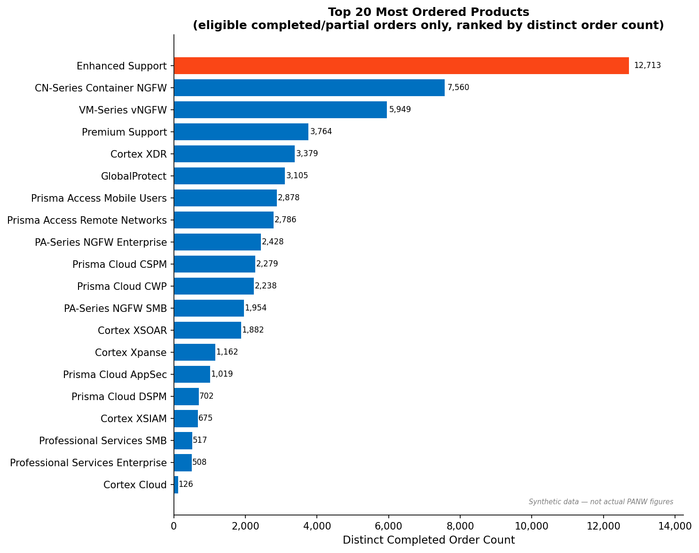

# Customer Retention and Revenue Growth

A B2B cybersecurity case study using **synthetic data**. The project connects data engineering, exploratory analysis, subscription-cancellation modeling, and a practical customer-review strategy. It is an independent exercise, not a Palo Alto Networks customer-data analysis or official company publication.

## Start here

- [Final presentation, including speaker notes](output/presentations/Case_Study_Retention_and_Revenue_Growth_2026-10-14.pptx)
- [Detailed results and limitations](output/model_demo_revision/RESULTS.md)
- [Simulation assumptions](part2/docs/simulation_assumptions.md) and [frozen evaluation design](output/model_demo_revision/frozen_design.md)
- [Feature definitions](part2/docs/feature_contract.md) and [target definition](part2/docs/target_definition.md)
- [Download full synthetic source and cleaned data](https://github.com/sriravi1996/panw-customer-retention-case-study/releases/tag/v1.0.0)

## Business problem and approach

Customer-success teams have limited capacity to review renewals. Which product subscriptions show warning signs, which accounts deserve a review, and where could healthy adoption support expansion?

One prediction row represents **one subscription product contract, 90 days before its expiry**. The positive outcome is a recorded cancellation observed through expiry plus 90 days. No recorded cancellation does not prove a successful renewal. A company may cancel a product while retaining others. Support products are excluded from the predictive cohort. Account reviews select one policy-specific lead contract per purchasing account.

The generated population has **10,000 purchasing accounts**, not 10,000 parent organizations. Related accounts can share a parent. Histories cover October 2021 to October 2026, with opening history from October 2018. All prices, contacts, activities, and outcomes are simulated.

## Part 1: generation, engineering and EDA

Core relational CSVs are `users`, `orders`, `order_items`, and `products`. Supplementary tables describe companies, parents, teams, deployments, weekly operating measurements, support tickets, interactions, renewal quotes, and contract events.

The generator runs renewal decisions in calendar order. A shared, noisy customer-experience state produces operational behavior and stochastic cancellation outcomes. Assumed annual risk anchors are 8% for SMB, 5% for midmarket, 2.5% for enterprise, and 1% for large enterprise. Contract-term conversion, experience interactions and switching-cost assumptions modify individual risk. These are explicit design assumptions, not measured PANW effects. Hidden simulation states never enter the model inputs.

Cleaning handles duplicates, invalid dates, missing observations, broken references and contract history. Point-in-time integration uses only information available at each prediction date. Unknown and inapplicable measurements remain distinct from confirmed zero use.

Required EDA answers are in [top 20 products by distinct order count](outputs/eda_top20_ordered_items.csv), [customer average-order-value analysis](outputs/eda_aov_analysis.csv), and [EDA summary](outputs/eda_summary.json). A product can lead dollar sales without leading order frequency. Average-order-value rankings disclose repeat-purchase eligibility.



## Part 2: modeling and evaluation

Compare prevalence and fixed health-rule baselines with logistic regression and histogram gradient boosting across experience, structural, and combined feature sets. The selected combined model uses **41 numeric and 4 categorical inputs**. Historical average precision selects the candidate, which is refitted on training plus selection data. Calibration and final-test periods remain separate, with temporal purges for outcome availability. Preprocessing is fitted on training data.

Report average precision, ROC-AUC, calibration diagnostics, and operational precision, recall and cancelled annual contract value (ACV) at fixed review capacities. Parent-group paired bootstrap intervals express uncertainty. Risk score × ACV is a prioritization index, not proven expected loss or revenue saved.

| Primary synthetic review, 30 accounts | Cancelled leads found | Precision | Cancelled ACV captured |
|---|---:|---:|---:|
| Health rules | 3 | 10.0% | 8.0% |
| Model score | 13 | 43.3% | 7.3% |
| Model score × ACV | 11 | 36.7% | 34.1% |
| ACV only | 0 | 0.0% | 0.0% |

Selected model: **full_context_hgb**. Primary temporal final-test average precision is **0.246**, versus **0.132** for health rules; ROC-AUC is **0.792**. Two additional, fixed synthetic seeds are evaluated with the frozen primary model. All three populations are reported in [the policy results](output/model_demo_revision/all_seed_policy_results.csv).

Leading inputs describe workflow success, protection coverage, business size, change in workflow success, and deployment reach. These reflect declared synthetic mechanisms, not discovered causal drivers at PANW. The scenario was developed after prior exploratory work; favorable performance demonstrates learning constructed mechanisms and cannot establish real-world effectiveness.

## Recommendations and measurement

1. Review unsuccessful workflows and deployment gaps; agree a measurable recovery milestone and owner.
2. Choose an account-ranking policy to match the objective: cancellation identification or financial exposure. Compare policies at actual review capacity.
3. Review healthy adoption and capacity needs before expansion. Quantity-dominant events represent 88.5% of synthetic full-history expansion value; this is descriptive, not causal.
4. Validate on real untreated customer data, then pilot documented interventions. Measure delivery feasibility first and use a controlled design for incremental retention impact. See [pilot protocol](part2/docs/pilot_protocol.md).

The current account list requires manual checks before outreach. All accounts are assumed directly managed; reseller-specific analysis is outside scope.

## Reproduce

Python 3.12 with the pinned dependencies is recommended.

```sh
python3 -m venv .venv
source .venv/bin/activate
python -m pip install -r requirements.txt
# Download the saved raw and cleaned data, or regenerate them:
python scripts/download_data.py
# Regeneration is optional and may take several minutes:
bash run_part1.sh
bash part2/run_part2.sh
python -m pytest part2/src/test_regression_fixtures.py src/test_experience_scenario.py -q
```

The final modeling dataset is included directly at [data/analysis/renewal_cohort_subscriptions.csv](data/analysis/renewal_cohort_subscriptions.csv). Full raw and cleaned tables are distributed in the release because weekly telemetry exceeds GitHub's normal per-file limit. The download script checks SHA-256 before extraction.

To regenerate the two replication populations and evaluate the frozen primary model:

```sh
python output/model_demo_revision/run_replications.py
python output/model_demo_revision/evaluate_frozen_replications.py
```

Replication generation is more expensive and does not retrain the primary model. See [presentation build instructions](part3/README.md) for optional Artifact Tool dependencies. Reviewing the PPTX requires no build tooling.

## Repository map

| Folder | Contents |
|---|---|
| `src/`, `config/` | Synthetic generation, cleaning, integration, EDA, and validation |
| `data/analysis/` | Final contract-level modeling datasets |
| `eval/` | Simulation-only ground truth, excluded from model features |
| `outputs/`, `figures/` | Part 1 quality reports, EDA answers, charts |
| `part2/src/`, `part2/models/`, `part2/outputs/` | Active modeling code, fitted artifacts, results |
| `part2/docs/`, `docs/` | Definitions, assumptions, interpretation, pilot |
| `part3/` | Presentation sources and data bundle |
| `output/presentations/` | One final presentation |
| `output/model_demo_revision/` | Frozen design and all-seed evaluation evidence |

No real customer data, private meeting transcript, credentials, old decks or review renders are included. Previous work is preserved in a local backup outside this submission.
